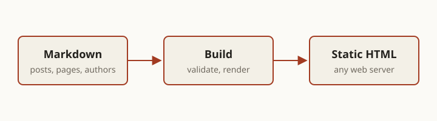

This post lives in its own folder, `posts/2026-05-02-markdown-tour/index.md`,
so its images sit beside it. The date prefix keeps the folder sorted and is
not part of the address.

## Code

Code is highlighted at build time by Shiki. No JavaScript reaches the reader.

```ts
export function comparePosts(a: Post, b: Post): number {
	if (a.date !== b.date) return a.date < b.date ? 1 : -1;
	return a.slug.localeCompare(b.slug);
}
```

Inline code such as `npm run build` works too.

## Callouts

:::tip
Five kinds exist: `note`, `tip`, `important`, `warning` and `caution`.
:::

:::warning[Custom title]
A label in brackets replaces the default title.
:::

## Images

An image beside the post is referenced by its file name. The build reads its
size and writes `width` and `height`, so the page does not jump while it loads.



## Tables and lists

| Syntax        | Result                |
|---------------|-----------------------|
| `**bold**`    | **bold**              |
| `~~strike~~`  | ~~strike~~            |
| `[x]` in list | a checked task        |

- [x] GitHub Flavored Markdown
- [x] Footnotes[^1]
- [ ] Math (planned)

### A third-level heading

Second- and third-level headings appear in the table of contents.

> Quotes are set off from the text around them.

[^1]: Footnotes are collected at the end of the post.
